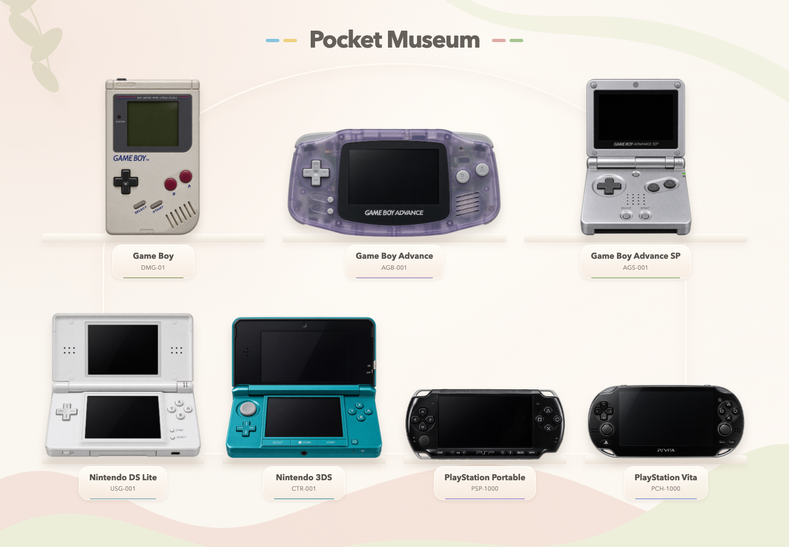

# Pocket Museum

浏览器掌机博物馆。首页选择七台掌机，在同一个 HTML 文档中进入机身、系统与游戏页面；可返回首页或切换机型。整体采用奶油白展馆、柔和圆角面板；七台掌机分别搭配绿、紫、冰蓝、青绿与蓝紫主题，背景和控件保持统一。

[源码](https://github.com/Sver0411/Pocket-Museum) · [发行文件](https://github.com/Sver0411/Pocket-Museum/releases) · [主题设计](docs/design/THEMES.md) · [逐阶段记录](docs/DEVELOPMENT_STAGES.md) · [验收记录](docs/ACCEPTANCE.md)



## 运行

Node.js 22、npm 10；开发及真实游戏测试环境为 macOS Chrome。

```sh
npm install
npm run dev
```

打开 [http://127.0.0.1:5173/](http://127.0.0.1:5173/)。没有独立后端：Vite 提供静态文件，模拟器、ROM、设置、媒体和存档均在浏览器本地处理。用户 ROM 不上传。

PSP 的 **更多 → 连接模拟器** 可连接本地 PPSSPP：真实按键/摇杆输入、暂停/恢复，点击共享窗口后把实时画面显示在机身 LCD。原生声音和存档留在 PPSSPP；[连接步骤与边界](docs/EXTERNAL_EMULATORS.md)。

```sh
npm run build            # TypeScript + 八份单文件 HTML + Vite 生产构建
npm test                 # 单元与存储迁移测试
npm run test:e2e          # 自动启动/复用开发服务，浏览器完整验收
npm run test:production   # 自动启动独立生产预览，验证构建后的真实核心与系统
npm run verify:assets    # 本地第三方文件 SHA-256 校验
npm run package:release  # 可运行工程 ZIP、八份离线 HTML ZIP、校验值
```

自动测试默认使用 Playwright 独立 Chromium，不占用日常 Chrome。首次测试前执行 `npx playwright install chromium`（Linux CI 使用 `--with-deps`）；只有显式设置 `POCKET_MUSEUM_BROWSER=chrome` 才使用系统 Chrome。GitHub Actions 配置在 `.github/workflows/ci.yml`。生产检查默认临时使用 4175 端口，结束自动关闭；通过 `POCKET_MUSEUM_PREVIEW_PORT` 可覆盖。

## 实际支持范围

| 机型 | 外观、控制与系统 | 真实游戏核心 | 本轮真实游戏验证 |
| --- | --- | --- | --- |
| Game Boy DMG-01 | 电源、整体受力十字键、对比度、无卡启动、160×144 | mGBA；GB / GBC 导入 | GB Snake：实体输入、即时保存/恢复、刷新；GBC 采用兼容模式，尚无独立彩色 ROM 验收 |
| GBA AGB-001 | 电源、肩键及所有面键、无卡启动、240×160 | mGBA；GBA | 2048 Advance：输入、音量、SRAM、即时存档 |
| GBA SP AGS-001 | 银色机身、前光、电源、肩键；半展开/完全展开/合盖 | mGBA；GBA | 同一 GBA 卡带与存档可跨 GBA/SP 使用；改变姿态保留实例 |
| DS Lite USG-001 | 白色机身、下屏触摸、实体音量；健康提示、时钟日历、设置、PictoChat；合盖睡眠 | DeSmuME；NDS | JamClown：单实例双屏、真实触摸计分、即时存档回退、合盖恢复 |
| 3DS CTR-001 | Circle Pad、深度/音量滑块；HOME、Mii、相机、Sound、笔记与设置；合盖睡眠 | **未接入** | 系统 UI / 本地应用，不是 3DS 游戏模拟 |
| PSP-1000 | XMB 分类、设置、模拟摇杆、媒体、音量/亮度；SOUND 短按均衡器、长按静音 | 网页核心未接入；可选本地 PPSSPP 连接 | 官方 WebSocket 控制与浏览器窗口共享；原生程序/存档由用户 PPSSPP 管理 |
| PS Vita PCH-1000 | 双摇杆、电源/音量、锁屏、气泡主页、LiveArea、Welcome Park、媒体、设置 | **未接入** | 未找到已验证的成熟官方 Web 核心；保留系统界面 |

3DS 参考 3.0.0-6E、PSP 参考 XMB 6.61、Vita 参考 3.74。这些是按资料实现的交互界面，**不是完整原版固件，也未完成外壳及全部系统应用 1:1**。不包含商业游戏、厂商 BIOS、固件或密钥，不显示 Nintendo 厂商 Logo；型号名称用于描述。支持用户自备合法的图标、背景、banner 与字体，[本地资源格式](docs/SYSTEM_RESOURCES.md)。

GBC 在 DMG 外壳中是明确标注的兼容体验，不是原始 DMG 硬件可以运行 CGB 专用卡带的声明。浏览器采用平面显示，3D 深度滑块不产生裸眼立体画面。无线、原机联机、商店、账号、USB、后触板和陀螺仪等未实现能力不会通过保存一个开关伪装成功。

## 游戏与存档

在 GB、GBA、SP 或 DS 页面选择卡带，再按电源。没有插卡时仍可进入无卡启动/系统页面。

- GB/GBC：`.gb` / `.gbc`，最大 8 MiB，校验 GB 头部与校验和；GB Snake 需先按一次 Start 唤醒，再按 Start 开始。
- GBA：`.gba`，最大 32 MiB，保留现有 GBA 文件头校验。
- DS：`.nds`，最大 256 MiB，校验 ARM 程序范围；使用单实例 256×384 输出，分别映射到两个 256×192 LCD。只有下屏接受触摸。
- EmulatorJS 固定 **4.2.3**；mGBA、DeSmuME 及解压资源本地部署，不依赖运行时 CDN，不附带 BIOS。
- ROM 以 SHA-256 识别。同名不同内容隔离存档。旧游戏缺少 `system` 字段时按 GBA 读取，不改变原 SHA 或 save key。
- 即时存档每个游戏一个槽位，保留核心名与 EJS 版本。读取需使用相同核心/版本；DS 状态约 12 MiB，比 GB/GBA 更耗内存。
- 原生存档需游戏确实写入。每 5 秒、正常关机/切换前同步非空保存到 IndexedDB；下次开机恢复。卡带菜单提供 mGBA `.sav/.srm`、DeSmuME `.dsv` 的导入导出。导入后重新开机读取。
- **GB Snake 无 SRAM，JamClown 本次未产生非空卡带保存**；不能把它们的即时存档通过当作原生存档通过。非空原生 SRAM 验证来自 GBA 的 2048 Advance。
- 强制关闭浏览器可能丢失最后几秒。清理站点数据会删除 ROM、设置、媒体及存档，请导出备份。

数据库继续使用 `pocketsp` **v2**，保留 v1→v2 升级。新增系统字段和每机型配置均在原有记录/设置表中存储，没有破坏式迁移。

## 操作与音效

方向键 / WASD 移动，X / Z 为 A / B，C / V 为 X / Y，Q / E 为 L / R，Enter / Shift 为 Start / Select。PSP/Vita 的 A、B、X、Y 对应 ×、○、△、□。Pointer Events 支持持续、多键、取消与失焦释放；标准 Gamepad API 支持手柄输入。摇杆逻辑与十字键的机械动画独立。

DS / 3DS 合盖暂停并恢复原状态；SP 合盖继续运行。完全展开使用独立正视素材和坐标，不拉伸半展开图片。上盖边缘可拖动。移动端隐藏两侧面板，通过紧凑操作条按需打开。

声音默认静音，明确操作后解锁 AudioContext。每机型独立保存音量、静音、屏幕与硬件设置。AudioManager 使用 Kenney 的 CC0 样本，按机型调整音色/速度，提供启动、关机、移动、按键、确认、返回、警告及音量渐变；Key Tone 实际控制提示音。Vita System Music 使用授权 CC0 的替代循环，离开系统/暂停/关机/静音时停止。**这些不是提取的原机音效或原厂音乐。** 游戏声音由核心单独输出，不叠加系统按键音。

PSP SOUND 短按只在手动“耳机模式”且播放 Memory Stick 音乐时切换均衡器，长按静音。浏览器无法可靠检测耳机插入。均衡器作用于本地音频的实际 Web Audio 滤波器。

媒体、相机、录音、Mii、笔记和同源 PictoChat 等现有功能继续保留。录音/相机只在用户操作后请求权限；退出释放设备。语言切换、网络等未实现选项会明确说明限制。原机各应用的完整页面/动画仍有差异，见调查与验收记录。

## 单文件版

[七机整合版](public/standalone/pocket-museum-all.html) · [GB](public/standalone/gb.html) · [GBA](public/standalone/gba.html) · [SP](public/standalone/sp.html) · [DS](public/standalone/ds.html) · [3DS](public/standalone/3ds.html) · [PSP](public/standalone/psp.html) · [Vita](public/standalone/vita.html)

八份 HTML 从同一套 React、CSS 与坐标配置生成，内嵌机身、交互、字体和授权提示音，可断网直接打开。整合版包含博物馆首页和七机切换，独立版只显示对应机型。**单文件版不包含游戏核心或 ROM，真实 GB/GBA/NDS 游戏请运行完整项目。** file:// 下存储、相机/录音等能力取决于浏览器限制，不承诺与 localhost 共享数据。

## 截图、调查与工程结构

最新实际运行截图位于 [docs/screenshots/current](docs/screenshots/current)，旧路径保留为历史回归证据。不要把历史 PocketSP 截图当作本轮成品。

| 文件/目录 | 作用 |
| --- | --- |
| `src/components/MuseumHome.tsx`、`src/museum.css` | 首页、简化游玩布局与响应式 |
| `src/components/Console.tsx`、`devices.ts`、`flatDevices.ts` | 机身、标定、姿态与实体控件 |
| `src/systems/` | 独立系统状态与本地应用 |
| `src/audio/AudioManager.ts` | 提示音、渐变、音乐与媒体均衡器 |
| `src/emulator/systems.ts` | 每机型能力/核心配置与演示清单 |
| `src/emulator/EmulatorAdapter.ts` | EmulatorJS 内部接口适配 |
| `src/emulator/EmulatorBridge.ts`、`protocol.ts` | 同源 iframe 会话、消息白名单、输入、触摸与存档 |
| `src/components/DsGameScreen.tsx` | 单个 DS 输出分成两个 LCD |
| `src/storage/database.ts` | v2 IndexedDB、SHA 身份与本地保存 |
| `scripts/`、`tests/`、`.github/workflows/ci.yml` | 单文件构建、校验、打包与自动化验收 |

第三方成品调查：[UI/字体/模型/音效](docs/research/THIRD_PARTY_UI.md)、[核心可行性及实测](docs/research/EMULATOR_FEASIBILITY.md)、[现有系统审查](docs/research/EXISTING_SYSTEMS_AUDIT.md)。官方资料与逐页范围见 [NATIVE_SYSTEMS](docs/research/NATIVE_SYSTEMS.md)，机身素材/提示词见 [ASSETS](docs/design/ASSETS.md)。

项目应用代码 GPL-3.0-or-later；第三方资源分别遵循 MIT、MPL、GPL、BSD、ISC、OFL、CC0 等许可。[完整 NOTICE 和源码快照](public/licenses/NOTICE.md)，固定文件的版本/来源/SHA 记录在 `public/assets-manifest.json`。核心 CDN 没有公布确切编译源码 commit；保存的源码快照和构建记录不等同于字节级可复现构建。

尚需实机验收：iOS Safari、真实手柄、低内存手机、持续音频性能；自动化注入手柄和移动视口不能替代这些结果。生成机身为图片/DOM/SVG/CSS 混合方案，尚非 CAD 或机械尺寸标定的完整实体复刻。
