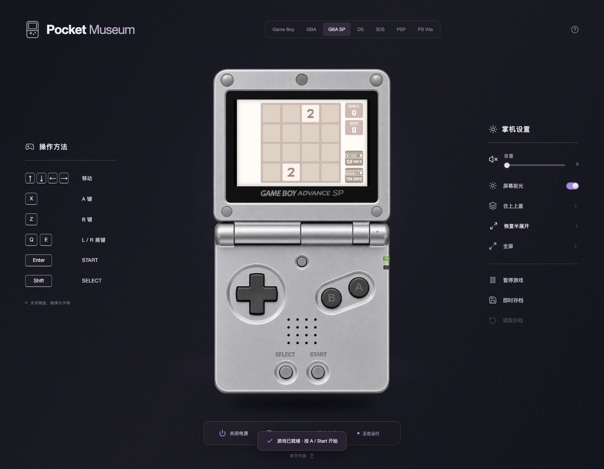

# Pocket Museum

口袋掌机博物馆。

[GitHub 源码](https://github.com/Sver0411/Pocket-Museum) · [下载工程与离线 HTML](https://github.com/Sver0411/Pocket-Museum/releases/tag/v0.1.1)

React + TypeScript + Vite 掌机界面项目。统一的深色展示环境、写实机身、空白关机屏幕，顶部在 **Game Boy、GBA、GBA SP、DS、3DS、PSP、PS Vita** 之间切换，始终保留在同一个 HTML 文档。

按最新设计要求，机身不显示 Nintendo 字样或椭圆 Logo，保留型号和实际按键标记，去掉装饰性小字。游戏画面不作为其他机型的演示内容。GBA 与 GBA SP 已接入真实 EmulatorJS / mGBA；七台机器已接入各自的无卡启动或首轮系统 UI。完整 1:1 外壳与系统应用复刻尚未完成，逐机进度和官方依据见 [系统范围记录](docs/research/NATIVE_SYSTEMS.md)。



翻盖机保留半展开展示，并使用独立正视素材提供完全展开游玩。按钮、屏幕和摇杆按新视角重新标定，切换姿态保留游戏进度。

## 运行

已在 Node.js 22 / npm 10、macOS、Chrome 验证。

```sh
npm install
npm run dev
```

打开终端显示的地址，默认 [http://127.0.0.1:5173/](http://127.0.0.1:5173/)。选择掌机不会导航到其他页面。

```sh
npm run build          # 类型检查、生成 8 个单文件 HTML、构建主项目
npm run preview        # 预览 dist 生产构建
npm test               # Vitest 单元测试
npm run test:e2e       # Playwright 浏览器验收，默认使用已安装的 Chrome
npm run test:production # 启动 4173 preview 后，验证生产构建的姿态和有效设置
npm run package:release # 打包离线 HTML 与完整可运行源码 ZIP
npm run verify:assets  # 核对固定模拟器、ROM、素材及许可文件的 SHA-256
```

Playwright 配置使用 `channel: 'chrome'`。若没有 Chrome，可先安装 Chrome，或者在 `playwright.config.ts` 中去掉 channel 并运行 `npx playwright install chromium`。已有 5173 开发服务时测试会复用它。

## 单文件交付

可以直接双击打开，无需 npm、服务器或网络：

| 文件 | 内容 |
| --- | --- |
| [public/standalone/pocket-museum-all.html](public/standalone/pocket-museum-all.html) | 七台掌机的整合单文件，顶部切换 |
| [public/standalone/gb.html](public/standalone/gb.html) | Game Boy |
| [public/standalone/gba.html](public/standalone/gba.html) | Game Boy Advance |
| [public/standalone/sp.html](public/standalone/sp.html) | Game Boy Advance SP |
| [public/standalone/ds.html](public/standalone/ds.html) | DS Lite |
| [public/standalone/3ds.html](public/standalone/3ds.html) | 3DS |
| [public/standalone/psp.html](public/standalone/psp.html) | PSP |
| [public/standalone/vita.html](public/standalone/vita.html) | PS Vita |

这些文件从同一套 React 组件、样式、机型坐标配置自动生成，内嵌所需机身图片、JS 和 CSS。每个独立版本只显示对应掌机；整合版包含全部机型。电源、暂停、合盖、亮度、音量界面、键盘、触摸、手柄和摇杆交互保持一致。

**单文件交付包含交互机身与首轮系统 UI，不内嵌游戏模拟器。** 电源开启后显示“系统运行”；GB/GBA/SP 显示无卡启动页，DS/3DS/PSP/Vita 显示自己的系统流程。真实 GBA 游戏使用项目主页面里的 GBA / GBA SP，相关资源也全部随项目保存。

重新生成单文件：

```sh
npm run build:standalone
```

主页面底部的“单文件版”可以下载当前机型。直接通过开发服务器访问 `/standalone/pocket-museum-all.html` 可预览整合版。

## 交互

- 方向键 / WASD：方向；X / Z：A / B；C / V：X / Y；Q / E：L / R；Enter / Shift：Start / Select。
- PSP / Vita 的 A、B、X、Y 输入分别对应 ×、○、△、□。
- 鼠标和触摸通过 Pointer Events 捕获，支持长按、同时按键、拖出按钮后释放、pointercancel 和失焦释放。
- 十字键使用同一个受力组件按照所按方向围绕中心倾斜，受力端下沉，对侧抬起，四个方向的输入命中区保持固定，支持斜向组合。PSP / Vita 的分区外观也使用联动图层，并遮罩保护机壳间隙。
- A/B、面键及系统键使用局部按压层，沿轴向小幅下沉；周围机壳不随按钮缩放。
- 3DS、PSP 的摇杆采用平面滑动，Vita 采用受限倾斜。支持圆形限位、方向输出、键盘斜向、松手回中；Vita 左右摇杆均可操作。摇杆的逻辑方向与十字键实体视觉分开，推摇杆不会压下十字键。切换机型、合盖、打开弹层和失焦会清理残留状态。
- PSP 的实体音量、亮度、静音按钮连接现有网页设置；PSP / 3DS / Vita 的 Home/PS 回到各自系统流程；网页使用指南仍通过右上角问号打开。
- 标准手柄：左摇杆 / 十字键控制方向，底部和右侧面键为 A / B，其他面键为 X / Y，肩键与菜单键按常规映射。连接后按任意键让浏览器识别。
- DS、3DS、GBA SP 支持半展开、完全展开和合盖；侧栏切换，机身上沿可拖动开合。完全展开将屏幕与控制面板平铺，保留游戏与系统状态。
- DS/3DS 合盖暂停，开盖恢复合盖前状态；手动暂停不会被开盖取消。GBA SP 按实机行为合盖继续运行。姿态切换释放输入。详见 [翻盖说明](docs/research/CLAMSHELL.md)。
- 关机屏幕空白、声音默认关闭。开机进入对应系统或已插入的 GBA 卡带。设置按钮共用相同布局与紫色交互点缀。

## GBA / GBA SP 的真实模拟器

在主页面切换到 GBA 或 GBA SP，通过机身外“选择卡带”插入 **2048 Advance 1.3.1**，再按电源启动。默认不插卡也可以开机，显示无卡启动页；“拔出卡带”会先关机保存。这是作者发布的原生 `.gba` homebrew，运行在真正的 mGBA WebAssembly 内，不是用 JavaScript 重写的 2048。

“选择卡带”也可导入本地 `.gba`，限制为 192 B–32 MB，检查 GBA 文件头。ROM 使用 File API 读入内存，按内容 SHA-256 识别、保存在当前浏览器的 IndexedDB，不上传。

EmulatorJS 固定为 **4.2.3**，明确指定 `mgba`。资源位于 `public/vendor/emulatorjs/4.2.3/`，包含普通与 legacy 核心、解压组件和版本报告。运行无需 CDN，也无需外部 BIOS。上游 localhost 版本检查的一个 URL 已改为本地 metadata，补丁说明保存在 `public/licenses/source/`。

存档：

- **原生存档**：先在游戏内保存；2048 游戏中按 Start。每 5 秒、切换卡带/掌机和正常关机时同步到 IndexedDB，下次启动恢复 SRAM。正常关机等待写入完成；强制结束进程仍可能丢失最后几秒。
- **即时存档**：每个 ROM 一个槽位，保存 / 恢复核心状态，携带核心与 EmulatorJS 版本信息。
- **.sav 导入导出**：位于卡带菜单。导入后重新开机让游戏读取。不同游戏、不同 ROM 修订版按 SHA-256 隔离。
- 浏览器清理站点数据会删除本地 ROM、设置和存档。原生存档可导出备份。

## 结构

```text
index.html                         主文档；所有掌机在此切换
emulator.html                      同源、独立的 mGBA iframe 运行页
src/App.tsx                        主界面与电源、游戏、存档协调
src/devices.ts                     七台机型的屏幕、按键和摇杆坐标
src/components/Console.tsx         写实机身、三种翻盖姿态、活动屏幕
src/components/LidCover.tsx        三种机型的 SVG 外侧盖板
src/flatDevices.ts                独立正视平铺机身及其屏幕、按键、摇杆坐标
src/components/projection.ts      半展开下屏与玻璃窗口的四角对齐
src/components/AnalogStick.tsx     平移 / 倾斜摇杆、限位与回中
src/components/DPad.tsx            整体受力十字键与分区遮罩
src/components/HardwareKey.tsx     通用命中区与 Pointer / 键盘释放
src/emulator/EmulatorAdapter.ts    唯一依赖 EmulatorJS 内部 API 的模块
src/emulator/EmulatorBridge.ts     请求 ID、超时、消息校验与连接生命周期
src/emulator/protocol.ts           版本化消息协议和按钮映射
src/emulator/runtime.ts            iframe 命令入口
src/input/InputController.ts       多来源按键持有、释放与手柄采样
src/storage/database.ts            IndexedDB v2、ROM、存档及媒体；保留 v1 数据升级
src/systems/                       原生系统状态、设置、媒体、相机、Mii 与聊天
scripts/build-standalone.mjs        同源代码生成 7 个单机版及 1 个整合版
public/assets/                     本地机身素材
public/standalone/                 可直接打开的单文件交付
public/licenses/                   第三方许可和源代码快照
```

主界面与 iframe 的消息包含 `channel: pocketsp:v1`、随机 session、请求 ID。两端核验 origin、source、session、命令类型和二进制大小；没有执行任意脚本或从外部 URL 加载用户 ROM 的命令。输入最终调用真实 `gameManager.simulateInput`，并关闭 iframe 自己的手柄轮询，避免双重输入。

内部数据库与通信标识沿用旧版本的命名，以兼容已有卡带、设置和存档。

## 素材、参考及剩余事项

机身采用生成的写实透明素材，并叠加真实 DOM 屏幕、命中区、按压图层和 CSS 翻盖；这是按后续“写实质感”要求采用的混合方案。显示层轻微平滑高频颗粒，保留轮廓和接缝。素材和完整提示词记录见 [docs/design/ASSETS.md](docs/design/ASSETS.md)。

官方参考：[Nintendo SP 技术尺寸](https://www.nintendo.com/en-gb/Support/Legacy-system/Technical-data-619375.html)、[SP 硬件照片与介绍](https://www.nintendo.com/en-gb/Hardware/Nintendo-History/Game-Boy-Advance-SP/Game-Boy-Advance-SP-627141.html)。官方照片没有被当作网页素材分发。

- 其他五台掌机的真实核心和游戏接入，按后续指示暂缓。
- 生成机身适合 UI 展示，不是尺寸精确的 CAD 复刻；背面、接口和合盖外壳仍可进一步细化。
- 已自动化模拟标准手柄输入与断开，尚未使用实体手柄和 iOS Safari 实机验收。
- 核心 CDN 报告没有给出其确切源码 commit。已保留版本、校验值、许可证、构建来源链接及接近构建日期的源码快照，未声称已完成字节级可复现构建。

第三方许可和 ROM 依赖调查见 [public/licenses/NOTICE.md](public/licenses/NOTICE.md)。应用代码使用 GPL-3.0-or-later；第三方素材、程序和游戏分别保留其许可。验证明细见 [docs/ACCEPTANCE.md](docs/ACCEPTANCE.md)，逐机控制审查见 [docs/CONTROL_AUDIT.md](docs/CONTROL_AUDIT.md)。

## 实机系统 UI

DS 的健康提示、时钟日历、菜单、PictoChat 本地输入、Download Play、设置与退出关机已接入；3DS 提供早期 HOME 菜单与布局/亮度/设置；PSP 提供 XMB 分类和设置；Vita 提供锁屏、气泡主页、LiveArea、应用和索引。系统按钮实际导航，设置保存于本机。

这些是根据官方手册实现的首轮界面，仍有字体、图标、动画和完整内置应用等未完成部分，不能当作完整原版系统。详见 [系统范围与资料](docs/research/NATIVE_SYSTEMS.md)。

第二轮补充了可保存的 Mii 编辑、16 页手写/文字笔记、浏览器相机 JPEG 拍照、录音与本地媒体播放、跨同源标签页的 PictoChat 文字/绘图、HOME 图标长按换位、真实系统时钟设置、书签和本地内容管理。媒体可通过机身外“导入媒体”加入；摄像头和麦克风只在按下对应按钮后请求浏览器权限。

`npm run build` 后可运行 `python3 scripts/package-html-release.py` 更新八个离线 HTML 的 ZIP、说明及 SHA-256 校验文件。图片、录音、Mii 和笔记仍仅保存于当前浏览器；不同浏览器及 file:// 文件未必共享同一存储。

`releases/pocket-museum-html.zip` 为八个自包含 HTML 及说明截图；`releases/pocket-museum-source.zip` 为完整可运行工程，解压后进入 PocketMuseum 文件夹运行 `npm install`、`npm run dev`。两者的校验值记录在 `releases/SHA256SUMS`。
